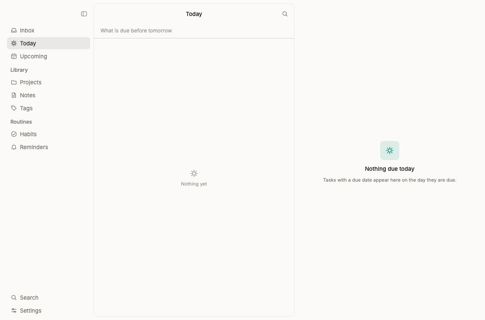
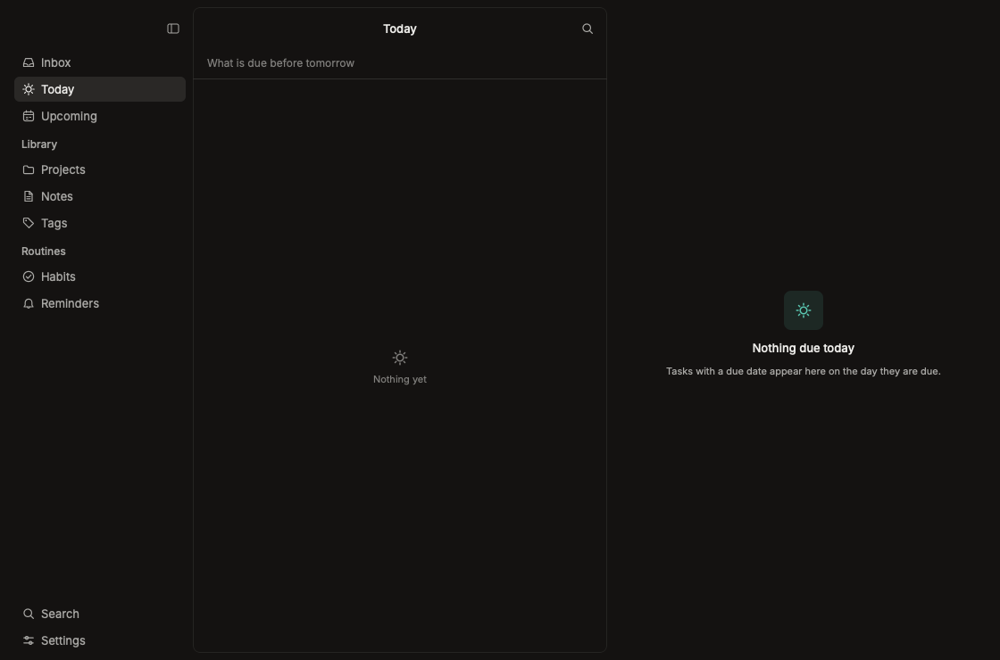
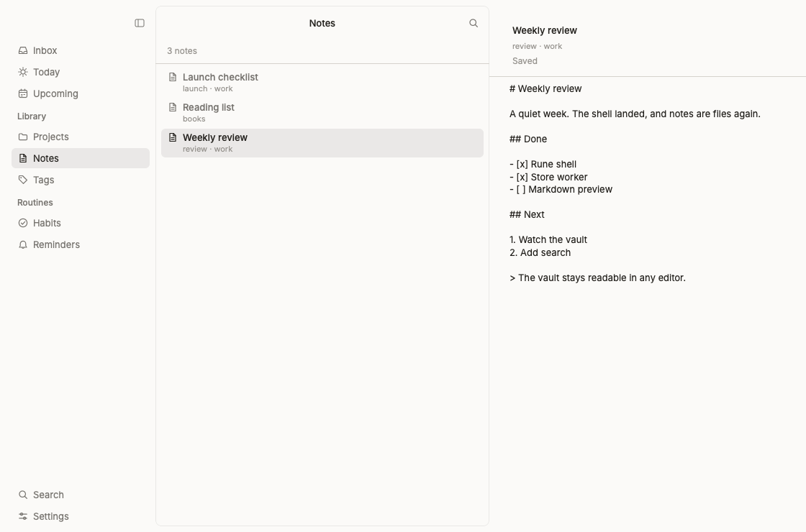
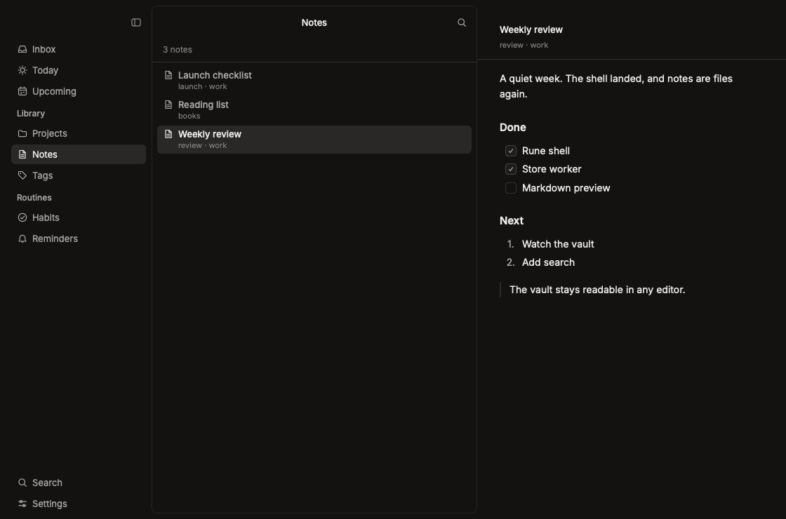

# openNoteX

Local-first notes, tasks, habits and reminders in one app.
Rust, [Rune](https://github.com/anomalyco/rune) for the UI, SQLite for the store.

**Status: `0.0.1` pre-alpha.** M0 (context, workspace, store, time, CI), M0.5
(the shell) and M1a are done: the app opens a window, indexes a real vault, lists
its notes and renders the selected note's Markdown. The note editor is next.

| | Light | Dark |
| --- | --- | --- |
| Today |  |  |
| Notes |  |  |

## The idea

Four primitives, one place:

| Pillar | Question it answers |
| --- | --- |
| Notes | What do I know? |
| Tasks | What do I owe? |
| Habits | What am I repeating? |
| Reminders | What must I not forget? |

They share one concept of "today", so the Today screen is the product.

## Principles

- **Local first.** No account, no network, no telemetry. Your data is a folder
  of Markdown files plus one SQLite database.
- **Files are yours.** Note bodies are `.md` files in a vault you choose, so
  Obsidian, git and any editor can read them. SQLite only indexes them.
- **Fast and light.** GPU-rendered native app, no webview, no JS runtime, no
  server, no async runtime. It draws nothing when idle.
- **One writer.** All SQLite and vault I/O goes through a single worker thread.

## Layout

```
crates/notex-core    entities, ids, invariants (no I/O)
crates/notex-time    day keys, recurrence, streaks, scheduler decisions (pure)
crates/notex-store   SQLite (migrations, pragmas, FTS, oplog) + Markdown vault
crates/notex-ui      the shell: routes, theme, three panes (pure view, no I/O)
apps/open-notex      the binary: window, key handling, the app's lifetime
vendor/              Rune's patched dependencies, copied at its pinned revision
xtask                seed data, benchmarks, snapshot runner
docs/                plan, architecture, data model, scheduling, testing
```

## Build and run

```sh
cargo build
cargo run -p open-notex               # opens the window on ~/Documents/Notes
cargo run -p open-notex -- --vault /path/to/notes
cargo test --workspace
cargo clippy --workspace --all-targets -- -D warnings
cargo fmt --check
cargo xtask snap                      # PNG + element tree for every scene
```

The vault is a folder of Markdown files; `--vault` overrides the default. The
index lives at `~/Library/Application Support/openNoteX/notex.db`, outside the
vault, and is rebuilt from the files at launch. Deleting it costs one reindex,
not a note.

The toolchain is pinned by `rust-toolchain.toml` (Rust 1.99.1) to match Rune.
`cargo xtask snap` writes to `artifacts/snaps`, which is not committed; the
stills in `docs/images/snaps/` are the reference set, one per scene per theme.

## Read next

- [`AGENTS.md`](AGENTS.md) — the rules that must survive every session.
- [`docs/PLAN.md`](docs/PLAN.md) — milestones and acceptance criteria.
- [`docs/ARCHITECTURE.md`](docs/ARCHITECTURE.md) — threads, data flow, ownership.
- [`docs/DATA-MODEL.md`](docs/DATA-MODEL.md) — schema and invariants.
- [`docs/SCHEDULING.md`](docs/SCHEDULING.md) — how reminders fire.
- [`docs/DECISIONS.md`](docs/DECISIONS.md) — why the stack is what it is.

MIT © OpenNoteX
